<div align="center">




<h2>🐺 About me</h2>

<p>
Hi, I'm <b>gunner667</b> — a <b>Frontend Developer</b> who builds clean, responsive and user-friendly web interfaces.<br/>
Like a witcher on a contract, I hunt down bugs, finish what I start and never leave a job half-done.
</p>

</div>

```js
const witcher = {
  name: "gunner667",
  role: "Frontend Developer",
  school: "School of the Wolf 🐺",
  arsenal: ["Git", "GitHub", "VS Code"],
  motto: "Clean code is the sharpest silver sword ⚔️",
};
```

<div align="center">


<h2>⚔️ Arsenal</h2>


<h2>📜 Statistics</h2>


<!--
  Когда появятся публичные репозитории, можно добавить карточку языков:
  
-->


</div>
